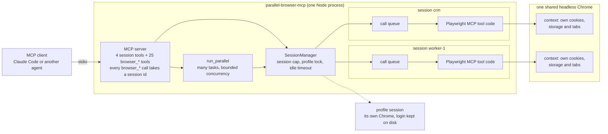

# parallel-browser-mcp

**Give an AI agent many isolated browsers at once.** An MCP server that runs Playwright MCP's own browser tools in many separate sessions, in parallel, inside one Chrome.

[](https://github.com/ruan-grobler/parallel-browser-mcp/actions/workflows/ci.yml)


[](LICENSE)

**The result.** The same 8 slow pages took 22.86 s one tab at a time and 6.38 s with 4 isolated sessions in parallel: 3.58x faster, with every value checked against the synthetic data. Measured on an Apple M1 laptop under load. A busier run gave 2.68x ([both runs](#the-result)).


<sub>From [docs/demo-output.txt](docs/demo-output.txt), the saved output of `npm run demo`. The per page table is cut for space where it says `...`.</sub>

## Quickstart

Needs Node.js 24 and Google Chrome.

```bash
npm ci
npm test
npm run demo
```

`npm test` builds and runs the end to end smoke test. `npm run demo` prints the before and after report and saves it to `docs/demo-output.txt`.

## Use it in Claude Code

From the repo folder, after `npm ci`:

```bash
npm run build && claude mcp add parallel-browser -s user -- node "$(pwd)/dist/index.js"
```

Remove it with `claude mcp remove parallel-browser -s user`. Any MCP client that speaks stdio works the same way.

## The problem

- AI agents and scrapers usually drive **one browser tab at a time**. Every page waits for the page before it.
- Running jobs side by side in **one shared browser** is risky. Cookies and logins from one job leak into the next. Two agents clicking in the same tab collide.
- Giving every job its own browser process fixes that, but it eats memory fast on a normal laptop.

## The result

The same 8 slow pages, read first one tab at a time, then 4 isolated sessions at a time:

| | Before | After |
|---|---|---|
| How | `run_parallel` with concurrency 1 | `run_parallel` with concurrency 4 |
| Wall clock | **22.86 s** | **6.38 s** |
| Pages ok | 8 of 8 | 8 of 8 |
| Values correct | 8 of 8 | 8 of 8 |

**3.58x faster, 72% less waiting.** Every page in both runs was checked against the synthetic data.

- Measured with `npm run demo` on a local mock site (127.0.0.1) where every page takes 1.5 s to answer. Synthetic data only.
- Measured on an Apple M1 laptop with 8 GB RAM, with other work running (load average 8.9). Your numbers will differ.
- Why not a full 4x: every task opens its own fresh session and page, and 4 pages loading at once share the CPU.
- Speed depends on machine load. A later run at load average 24.6 gave 18.95 s before and 7.08 s after, 2.68x faster. Both reports are below.
- Full report: [docs/demo-output.txt](docs/demo-output.txt).

<details>
<summary>Demo output from both runs</summary>

The run in the table, saved as `docs/demo-output.txt`:

```text
parallel-browser-mcp demo: the same 8 pages, one tab at a time, then 4 at a time
Run 2026-10-21 on darwin arm64, Apple M1, 8 cores, 8 GB RAM, Node v24.13.1, Chrome 155, load average 8.9 at start
Synthetic data: 8 catalogue pages on a local mock site (127.0.0.1). Each page takes 1500 ms to answer.
Each task opens its page, then reads the SKU and stock with browser_evaluate, in its own throwaway session.

Chrome start and first page, not counted in either run: 5.06 s

BEFORE: concurrency 1
  server says: run_parallel: 8 tasks, 8 ok, 0 failed. Took 22.8s (one by one would be about 22.8s), concurrency 1.
  wall clock 22.86 s, pages ok 8, failed 0, data correct 8 of 8

AFTER: concurrency 4
  server says: run_parallel: 8 tasks, 8 ok, 0 failed. Took 6.4s (one by one would be about 25.3s), concurrency 4.
  wall clock 6.38 s, pages ok 8, failed 0, data correct 8 of 8

Seconds per page (each task, from the server report)
  page  SKU        stock  before  after
  1     DEMO-001   7      2.7s    3.3s
  2     DEMO-002   14     2.9s    3.1s
  3     DEMO-003   21     2.4s    3.1s
  4     DEMO-004   5      2.4s    3.1s
  5     DEMO-005   12     4.4s    3.2s
  6     DEMO-006   19     2.7s    3.2s
  7     DEMO-007   3      2.7s    3.2s
  8     DEMO-008   10     2.6s    3.1s

RESULT
  8 pages: 22.86 s before, 6.38 s after
  speed-up 3.58x, 16.48 s saved (72% less waiting)
  Lower bound from the page delay alone: 12.00 s one at a time, 3.00 s with 4 at a time.
  All pages loaded and every value matched the synthetic catalogue.
```

The later run, at load average 24.6:

```text
parallel-browser-mcp demo: the same 8 pages, one tab at a time, then 4 at a time
Run 2026-10-21 on darwin arm64, Apple M1, 8 cores, 8 GB RAM, Node v24.13.1, Chrome 155, load average 24.6 at start
Synthetic data: 8 catalogue pages on a local mock site (127.0.0.1). Each page takes 1500 ms to answer.
Each task opens its page, then reads the SKU and stock with browser_evaluate, in its own throwaway session.

Chrome start and first page, not counted in either run: 1.42 s

BEFORE: concurrency 1
  server says: run_parallel: 8 tasks, 8 ok, 0 failed. Took 18.9s (one by one would be about 18.9s), concurrency 1.
  wall clock 18.95 s, pages ok 8, failed 0, data correct 8 of 8

AFTER: concurrency 4
  server says: run_parallel: 8 tasks, 8 ok, 0 failed. Took 7.1s (one by one would be about 28.3s), concurrency 4.
  wall clock 7.08 s, pages ok 8, failed 0, data correct 8 of 8

Seconds per page (each task, from the server report)
  page  SKU        stock  before  after
  1     DEMO-001   7      2.5s    3.5s
  2     DEMO-002   14     2.3s    3.5s
  3     DEMO-003   21     2.3s    3.5s
  4     DEMO-004   5      2.3s    3.5s
  5     DEMO-005   12     2.3s    3.5s
  6     DEMO-006   19     2.3s    3.5s
  7     DEMO-007   3      2.4s    3.5s
  8     DEMO-008   10     2.5s    3.5s

RESULT
  8 pages: 18.95 s before, 7.08 s after
  speed-up 2.68x, 11.87 s saved (63% less waiting)
  Lower bound from the page delay alone: 12.00 s one at a time, 3.00 s with 4 at a time.
  All pages loaded and every value matched the synthetic catalogue.
```

</details>

## How it works



- **One Chrome, many contexts.** A session is a browser context inside one shared Chrome. It has its own cookies, storage and tabs, and it is far lighter than a browser process per job.
- **Playwright MCP's own code, per session.** Each session runs its own in-process instance of [Playwright MCP](https://github.com/microsoft/playwright-mcp) against its context. Same 25 `browser_*` tools, same snapshots and refs. An upgrade is a version bump.
- **A session id on every tool.** Calls on different sessions run at the same time. Calls on one session queue in order.
- **`run_parallel`.** One tool call runs many tasks at once, server side. Each task is a list of `browser_*` steps.
- **Log in once, fan out.** A `profile` session keeps its login on disk. `cloneFrom` copies cookies and storage into new workers.

## Tools

| Tool | What it does |
|---|---|
| `browser_*` (25) | Playwright MCP tools, plus an optional `session` (default `"default"`) |
| `session_create` | Open a session with options: `headed`, `profile`, `cloneFrom`, `device`, `viewport`, `userAgent`, `locale`, `timezoneId`, `blockResources` |
| `session_list` | Open sessions, their tabs, busy or idle |
| `session_close` | Close one session, or `all: true` |
| `run_parallel` | Many tasks at once, each a list of `browser_*` steps |

## Patterns

**Parallel subagents.** Give each agent its own session id (`agent-1`, `agent-2`). They never share a tab.

**Read many pages in one call.**

```json
{
  "tasks": [
    { "steps": [
      { "tool": "browser_navigate", "args": { "url": "https://example.com/products/1" } },
      { "tool": "browser_evaluate", "args": { "function": "() => document.body.innerText.slice(0, 2000)" } }
    ] },
    { "steps": [
      { "tool": "browser_navigate", "args": { "url": "https://example.com/products/2" } },
      { "tool": "browser_evaluate", "args": { "function": "() => document.body.innerText.slice(0, 2000)" } }
    ] }
  ],
  "concurrency": 4
}
```

- A task without a `session` gets a throwaway session that closes when the task ends.
- Steps can click or type with CSS selectors (`"target": "#submit"`). No snapshot needed.
- Output defaults to each task's last step. Use `"output": "all"` for every step.

**Log in once, fan out.**

1. `session_create` with `{ "session": "crm", "profile": "crm", "headed": true }`, then log in by hand in the window. The login is saved to disk.
2. Workers: `session_create` with `{ "session": "w1", "cloneFrom": "crm" }`. They start logged in.

## Settings

Flags go after `dist/index.js` in the MCP config.

| Flag | Default |
|---|---|
| `--headed` | off (headless) |
| `--browser chrome\|msedge\|chromium` | `chrome` (the installed Google Chrome) |
| `--max-sessions <n>` | 8 |
| `--concurrency <n>` | 4 |
| `--idle-minutes <n>` | 30 (headless sessions only, 0 means never) |
| `--caps <list>` | none, for example `vision,pdf` |
| `--data-dir <path>` | `~/.parallel-browser` (profiles and output files) |

## How it fails safely

- **Session cap.** At most `--max-sessions` sessions are open (default 8). One more gets a clear error that lists the open sessions and says how to free one. `run_parallel` checks for free slots before it starts and lowers its concurrency to fit.
- **One failure stays one failure.** A failing step marks only its own `run_parallel` task `FAILED`, with the step and the error. The other tasks keep running and their results still come back. The whole call is an error only when every task failed.
- **Timeouts.** Each task has a time limit (`taskTimeoutSeconds`, default 180). Each tool call inside a session has a 5 minute limit that resets on progress.
- **Cancellation.** If the client cancels, tasks that have not started are skipped and reported as `cancelled`. The cancel signal is passed on to the running tool calls.
- **Same-session queue.** Calls on one session run one at a time, in order, so two agents never act on the same tab at once. A failed call does not block the next one. Different sessions never wait for each other.
- **Throwaway sessions always close.** A task without a session id gets a fresh session that closes when the task ends, also after an error or a timeout. It can never take over a session someone else is using.
- **Profile lock.** A saved login profile can be open in one session at a time. The error names the session that holds it and suggests `cloneFrom`.
- **Idle timeout.** Headless sessions that sit idle for 30 minutes (`--idle-minutes`) close and free their memory. Headed windows are left for the person using them.
- **Recovery.** If a window is closed by hand, the next call opens a fresh context. If Chrome fails to start, the call returns a tool error and the next call tries again.
- **Output budget.** By default each task's text is capped at 6,000 characters, and lower for big batches so a whole batch stays under 80,000. A note says how much was cut. One batch cannot flood the client.
- **Clean shutdown.** When the client disconnects, or on SIGINT or SIGTERM, the server closes every session and browser, waiting at most 5 seconds before it exits. The smoke test checks that no Chrome process is left behind.
- **Local only.** It speaks MCP over stdio and opens no network port.
- **No automatic retries.** A failed or timed out task comes back with its error, and the caller decides whether to run it again. A blind retry of a click or a form submit could repeat the action.

## Tests

CI runs the typecheck, the unit tests with coverage and the smoke test on every push and pull request. There is no linter in this repo.

### Unit tests: `npm run test:coverage`

90 tests on `node:test`, with mocks and no browser:

- `run_parallel` gets a mock session manager.
- The server is driven by a real MCP client over an in-memory transport, with a mock session manager.
- Sessions get a fake browser pool, and the pool gets a fake `chromium.launch`.
- Two tests load the real Playwright MCP package, to list its tools and to check a browser that cannot start. Neither launches a browser.

```text
ℹ tests 90
ℹ suites 24
ℹ pass 90
ℹ fail 0
ℹ cancelled 0
ℹ skipped 0
ℹ todo 0
ℹ duration_ms 657.536042
ℹ start of coverage report
ℹ -----------------------------------------------------------------
ℹ file         | line % | branch % | funcs % | uncovered lines
ℹ -----------------------------------------------------------------
ℹ src          |        |          |         | 
ℹ  browsers.ts | 100.00 |   100.00 |  100.00 | 
ℹ  config.ts   | 100.00 |   100.00 |  100.00 | 
ℹ  parallel.ts |  89.44 |    98.72 |   94.12 | 1-2 4-9 11-18 20-22
ℹ  server.ts   | 100.00 |    95.74 |  100.00 | 
ℹ  sessions.ts |  99.30 |    97.30 |   91.11 | 136-137
ℹ -----------------------------------------------------------------
ℹ all files    |  97.46 |    97.97 |   94.79 | 
ℹ -----------------------------------------------------------------
ℹ end of coverage report
```

- `parallel.ts` lines 1 to 22 are type declarations. They compile away, and source-mapped coverage counts them as uncovered.
- `sessions.ts` lines 136 and 137 forget a failed Playwright MCP connection so the next call reconnects. No unit test makes that connection fail.
- `index.ts` is the process entry point. Loading it starts the stdio server, so the unit tests do not load it. The smoke test runs it end to end.

<details>
<summary>Every unit test from that run</summary>

```text
▶ shared browser
  ✔ launches one browser per mode and reuses it for every context (1.345792ms)
  ✔ uses the bundled Chromium channel only when asked (0.151125ms)
  ✔ relaunches after the browser disconnects (0.148541ms)
  ✔ forgets a failed launch so the next call tries again (0.339875ms)
  ✔ closeShared closes one mode and closeAll closes the rest (0.212792ms)
  ✔ a browser that fails to close does not stop shutdown (0.111625ms)
✔ shared browser (2.970042ms)
▶ profiles
  ✔ a profile gets its own persistent browser in the profile folder (0.174709ms)
✔ profiles (0.225542ms)
▶ context options
  ✔ applies a device first, then explicit options on top (0.182917ms)
  ✔ fails fast on an unknown device, before any browser starts (0.167875ms)
  ✔ blockResources aborts the listed resource types and lets the rest through (0.227042ms)
  ✔ no blockResources means no request routing (0.066958ms)
✔ context options (0.732416ms)
▶ loadConfig
  ✔ uses safe defaults when no flags are given (2.26725ms)
  ✔ parses every flag (0.46775ms)
  ✔ caps concurrency at the session limit (0.117917ms)
  ✔ keeps sessions and concurrency at 1 or more (0.085833ms)
  ✔ treats an empty --caps list as no extra capabilities (0.086958ms)
  ✔ rejects an unknown browser with the allowed list (0.303792ms)
  ✔ rejects numbers that are not whole and positive (0.157166ms)
  ✔ rejects unknown flags instead of ignoring them (1.093208ms)
✔ loadConfig (5.558166ms)
▶ USAGE and VERSION
  ✔ USAGE documents every flag (0.118209ms)
  ✔ VERSION comes from package.json (7.247625ms)
✔ USAGE and VERSION (7.492125ms)
▶ step validation
  ✔ rejects a step that is not a browser tool before anything runs (2.387333ms)
  ✔ browser_close is not a step, closeAfter is the way to close (0.121625ms)
✔ step validation (3.264709ms)
▶ session slots
  ✔ refuses up front when no session slots are free (0.176625ms)
  ✔ still runs tasks on open named sessions when every slot is taken (6.213208ms)
  ✔ reports a session that cannot be created as that task's error (0.640667ms)
✔ session slots (7.148375ms)
▶ concurrency
  ✔ runs at most `concurrency` tasks at once (44.164833ms)
  ✔ caps concurrency at the free session slots (46.332125ms)
  ✔ caps concurrency at the number of tasks and falls back to the server default (5.979208ms)
✔ concurrency (96.82625ms)
▶ results and failures
  ✔ returns the last step by default and every step with output: all (7.040542ms)
  ✔ one failing task does not sink the batch (2.612125ms)
  ✔ stops a task at its first failing step unless stopOnError is false (3.586375ms)
  ✔ flags the whole result as an error only when every task failed (6.189625ms)
  ✔ errorMessage reads Error objects and anything else (0.264084ms)
✔ results and failures (20.35425ms)
▶ sessions inside a batch
  ✔ throwaway tasks get their own session and always close it (0.870875ms)
  ✔ named sessions stay open unless closeAfter is set (1.694167ms)
  ✔ reuses an open named session and says its create options were ignored (2.171834ms)
  ✔ passes create options to a new named session (0.728083ms)
  ✔ ignores a stray session arg inside a step (2.104292ms)
✔ sessions inside a batch (7.95275ms)
▶ output budget
  ✔ truncates long text to maxChars and says how much was dropped (0.433042ms)
  ✔ keeps images and only counts text against the budget (0.34725ms)
  ✔ shrinks the default budget for big batches (0.517958ms)
✔ output budget (1.448291ms)
▶ timeouts and cancellation
  ✔ times out a slow task and still closes its session (53.169833ms)
  ✔ a request cancelled before it starts opens no sessions (0.630708ms)
  ✔ cancelling mid-batch skips the tasks that have not started (0.464167ms)
✔ timeouts and cancellation (54.666959ms)
▶ tool list
  ✔ has the session tools plus every Playwright MCP tool, each with an optional session arg (4.594167ms)
  ✔ tells the client its limits (1.642958ms)
✔ tool list (26.241167ms)
▶ browser_* routing
  ✔ sends each call to its session, "default" when none is given (2.905917ms)
  ✔ rejects a session that is not a string (0.966125ms)
  ✔ answers an unknown tool with a clear error (0.7415ms)
  ✔ turns manager errors into tool errors (0.78025ms)
  ✔ browser_close closes the session it names (0.895209ms)
✔ browser_* routing (6.445417ms)
▶ session tools
  ✔ session_create validates ids, profile names and options before creating anything (2.838167ms)
  ✔ session_create starts the session and says how to use it (0.910666ms)
  ✔ session_create closes the session again when the browser fails to start (0.632459ms)
  ✔ session_list shows the count and every session (0.761083ms)
  ✔ session_close closes one or all, and explains a bad request (1.063875ms)
✔ session tools (6.327709ms)
▶ run_parallel
  ✔ validates the batch before running anything (2.402458ms)
  ✔ runs the steps in the named session (1.297209ms)
✔ run_parallel (3.7695ms)
▶ session ids
  ✔ accepts letters, digits, dot, dash and underscore up to 64 characters (0.762792ms)
  ✔ rejects anything else with a clear message (0.650708ms)
  ✔ rejects a duplicate id (0.0835ms)
✔ session ids (3.512875ms)
▶ session cap
  ✔ refuses one more session than --max-sessions and lists what is open (0.133375ms)
  ✔ frees the slot when a session closes (0.157375ms)
✔ session cap (0.352709ms)
▶ profiles and cloneFrom
  ✔ validates profile names (0.142417ms)
  ✔ locks a profile to one session at a time (0.1195ms)
  ✔ refuses profile and cloneFrom together (0.074708ms)
  ✔ refuses to clone a session that is not open (0.067083ms)
  ✔ copies cookies and storage from the source session (0.270334ms)
✔ profiles and cloneFrom (0.786042ms)
▶ session lifecycle
  ✔ creating a session does not start a browser (0.112875ms)
  ✔ headed overrides the server default, otherwise the default applies (0.072375ms)
  ✔ start opens the context once and describe shows its tabs (0.108917ms)
  ✔ describe shows how long a session has been idle (0.134375ms)
  ✔ getOrCreate reuses an open session (0.067666ms)
  ✔ the shared browser closes only when its last session closes (0.418125ms)
  ✔ closing a profile session leaves the shared browser alone (0.092666ms)
  ✔ close only closes the exact session it was given (0.06075ms)
  ✔ closeAll closes every session and the pool (0.088583ms)
  ✔ a closed session refuses new calls (0.11925ms)
✔ session lifecycle (1.400417ms)
▶ recovery
  ✔ a window closed from outside is replaced on the next use (0.105292ms)
  ✔ a context that fails to open is retried on the next use (0.081541ms)
  ✔ through the real Playwright MCP code, a browser that cannot start is a tool error and is retried (17.238542ms)
✔ recovery (17.498042ms)
▶ call queue
  ✔ calls on one session run one at a time, in order (67.317833ms)
  ✔ different sessions do not wait for each other (22.103833ms)
  ✔ a failed call does not block the next one (43.652292ms)
  ✔ a call still queued when its session closes is refused (22.226417ms)
  ✔ every call carries a 5 minute timeout and the caller's abort signal (1.691916ms)
✔ call queue (157.301292ms)
▶ idle timeout
  ✔ closes idle headless sessions and leaves headed windows open (1.234833ms)
  ✔ --idle-minutes 0 never starts the timer (0.365917ms)
✔ idle timeout (1.756125ms)
▶ Playwright MCP tools
  ✔ lists Playwright MCP's own tool definitions without launching a browser (6.945125ms)
✔ Playwright MCP tools (6.993708ms)
```

</details>

### Smoke test: `npm test`

24 end to end checks. It starts the built server over stdio, the way Claude Code does, and drives real headless Chrome against a local test site on 127.0.0.1. The parallel check compares the wall clock with the server's sum of task times, so it holds on a slow or busy machine.

```text
PASS  lists Playwright tools plus session tools  (29 tools)
PASS  browser_* tools take a session arg
PASS  first call launches Chrome and navigates  (3198ms)
PASS  run_parallel returns every task result
PASS  run_parallel runs tasks at the same time  (3772ms for 4 pages that each take 2000ms, 4.0 at once on average)
      run_parallel: 4 tasks, 4 ok, 0 failed. Took 3.8s (one by one would be about 15.0s), concurrency 4.
PASS  throwaway batch sessions close afterwards
PASS  direct calls on different sessions run at the same time  (2842ms for 2 x 2000ms)
PASS  same-session calls run one after another  (2099ms)
PASS  sessions do not share cookies
PASS  cloneFrom copies the login into a new worker
PASS  session cap gives a clear error
PASS  run_parallel refuses when no slots are free
PASS  session_list shows open sessions
PASS  browser_close and session_close free their slots
PASS  run_parallel steps can target CSS selectors
PASS  named batch sessions stay open
PASS  failures are reported per task
PASS  rejects steps that are not browser tools
PASS  rejects bad session ids
PASS  session_close all
PASS  a profile can only be open in one session
PASS  profile login survives close and reopen
PASS  Chrome runs as a child of the server  (1 child process(es))
PASS  closing the client shuts every browser down

ALL PASSED
```

## Stack

- **TypeScript**, strict mode, compiled with `tsc` (TypeScript 7).
- **Node.js 24**, in CI and for every number in this README.
- **[@playwright/mcp](https://github.com/microsoft/playwright-mcp)** 0.0.83 for the browser tools, and **playwright-core** to drive Chrome.
- **@modelcontextprotocol/sdk** 1.32.1 for the MCP server and the in-process clients.
- **zod** 4 for input validation.
- **node:test** for unit tests and coverage. No test framework dependency.
- **GitHub Actions** on `ubuntu-latest`, which ships Google Chrome.

## Credits

Built on [Playwright MCP](https://github.com/microsoft/playwright-mcp) by Microsoft, licensed Apache-2.0. This project installs it from npm and runs its tool code once per session. It does not copy or change its source.

## What I would do next

- **Opt-in retries** per task with backoff, for flaky pages. Off by default, because a retried click can submit a form twice.
- **A memory-aware cap**, so new sessions are refused when Chrome nears a memory limit, not at a fixed count.
- **Progress per task**, with MCP progress notifications, so a long batch shows which pages are done.
- **A per-site rate limit** in `run_parallel`, to stay polite to one domain.
- **More CI runners**: the smoke test on macOS and Windows too.

## License

MIT. See [LICENSE](LICENSE).
